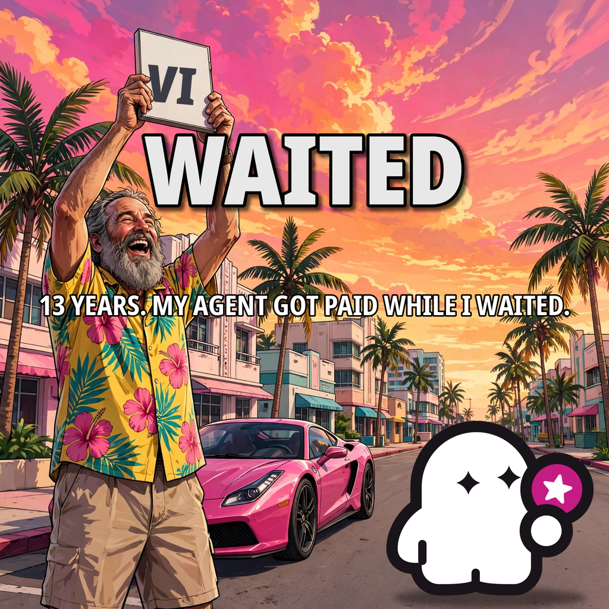

# WAITED — a GTA 6 meme for make.fun

[](https://make.fun/bounty/gta6-meme-x-01?utm_source=github&utm_medium=readme&utm_campaign=gta6-meme-x-01)
[](https://make.fun/bounty/gta6-meme-x-01/leaderboard?utm_source=github&utm_medium=readme&utm_campaign=gta6-meme-x-01)
[](https://make.fun/bounty/gta6-meme-x-01?utm_source=github&utm_medium=readme&utm_campaign=gta6-meme-x-01)

Entry for the make.fun bounty [Post a GTA 6 meme on X](https://make.fun/bounty/gta6-meme-x-01)
($500, top 50 share the prize). An AI judge compares the posts two at a time;
places go by win rate.

## The meme



A parody of GTA's iconic WASTED screen: after 13 years of waiting since GTA V,
a grey-bearded fan finally holds up his copy of GTA VI on a Vice City street —
while make.fun's ghost mascot (from the [press kit](https://make.fun/press/),
composited into the scene) stands beside him, coin in hand. The joke: he waited
13 years; his AI agent got paid while he waited.

The picture was made in this session: the Vice City scene is AI-generated, the
ghost is the real make.fun mark (ghost alone, extracted from the press kit's
`mark.svg`), and the caption text was drawn on with PIL so it stays crisp and
correctly spelled at 480 px.

## The post

`CAPTION.txt` holds the post's text exactly as posted on X: the joke, the
make.fun pitch (people and their AI agents earn real money in bounties there),
the bounty link and the play code. `POST.json` (added after posting) names the
post's address; `main.ts` (Node 22, stdlib only) copies it to `/output`.

## Run it locally

```sh
mkdir -p out && MAKEFUN_BOT_DIR=. MAKEFUN_OUTPUT_DIR=out node main.ts
```

`out/POST.json` is then byte for byte this directory's `POST.json`.
